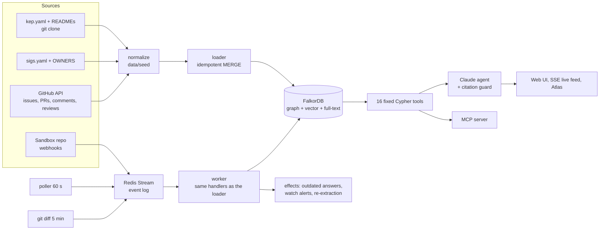
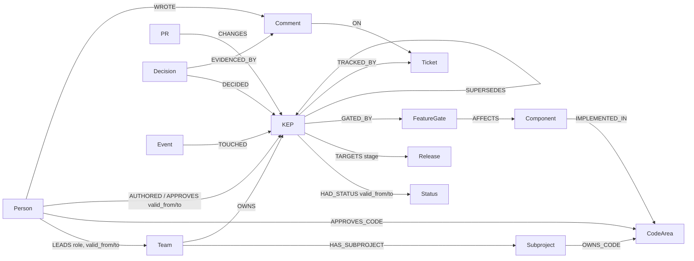

# Decision Brain

A Company Brain agent on FalkorDB. It models the Kubernetes project as a company: SIGs are teams, KEPs are decisions, issues and pull requests are the conversations, and OWNERS files are code ownership. All of it lives in one graph that keeps itself current. The agent answers **who owns or knows what, why something was decided, what a change affects, what changed, and what a design doc or discussion says**. Every answer shows its sources, the graph path it used and the Cypher behind it. It can also get work done: draft a decision brief, suggest reviewers, route a question, or watch a KEP.

**Live demo:** https://16-112-242-222.sslip.io · **Graph Hacks 2026 (WeMakeDevs × FalkorDB), Track 3: Company Brain**


## Overview

| Ask | What happens |
|---|---|
| *Who owns the kubelet?* | Component → code areas → owning SIG, its current leads, and the code approvers |
| *Why was classic DRA (KEP-3063) withdrawn?* | Status history with the PRs that changed it, what replaced it, and a quote-checked rationale |
| *What was the status of KEP-2699 as of v1.30?* | Time travel: every status, lead and approver is an interval with dates |
| *What does KEP-4381 affect?* | KEP → feature gates → components → code areas → the people who must know |
| *What changed in sig-node since August?* | Change events written by the real-time engine |
| *What are the non-goals of KEP-753? What did reviewers say on PR #4255?* | Reads the design-doc section or the thread, and quotes it with links |
| *Who approved the quantum teleport scheduler?* | "Not in the graph". Invented things are never answered |

**Why a graph:** on the same 50 questions with the same model and data, the graph agent scored **49/50**, while vector-only search over the same documents scored **15/50**. While two years of real changes streamed in, the graph stayed right on **84/90** checks against **32/90**. See [Evaluation](#evaluation).

**Atlas:** the whole company as one living graph: 49 teams, 661 KEPs, 502 code areas and the people around them. Hover to trace connections, play the history from 2020 to today, and watch nodes pulse when a live change lands.


## Quick start

**Use the live demo.** Example questions are served from recorded answers. Other questions run live, limited to 10 per hour per visitor.

**Run it locally** (Docker and Python 3.10+). No GitHub token is needed: the normalized data is committed in `data/seed`.
```bash
git clone https://github.com/bibek198/decision-brain.git && cd decision-brain
cp .env.example .env                      # add ANTHROPIC_API_KEY, or set DEMO_REPLAY=1 for recorded answers
docker compose up -d                      # FalkorDB on localhost:6379
python -m venv .venv && .venv/bin/pip install -r requirements.txt
.venv/bin/python scripts/bootstrap.py     # clones the 2 repos, loads brain_eval (~5 min), copies brain_demo / brain_live
.venv/bin/uvicorn web.app:app --port 8000 # open http://localhost:8000 (add #atlas for the Atlas)
```

**Ask from the command line:**
```bash
.venv/bin/python -m src.agent.cli "Why was classic DRA (KEP-3063) withdrawn?" --trace
DEMO_REPLAY=1 .venv/bin/python -m src.agent.cli "Who owns the kubelet?"     # recorded answer, no API key needed
```

**Use the same tools from Claude Desktop or any MCP client.** All 16 tools (12 read tools, 4 actions) are served over MCP:
```bash
npx @modelcontextprotocol/inspector .venv/bin/python -m src.mcp_server
```
For Claude Desktop, add this to `claude_desktop_config.json`, using absolute paths (Claude Desktop ignores `cwd`):
```json
{ "mcpServers": { "decision-brain": {
    "command": "/ABSOLUTE/PATH/decision-brain/.venv/bin/python",
    "args": ["/ABSOLUTE/PATH/decision-brain/src/mcp_server.py"] } } }
```

The production setup (EC2, Caddy HTTPS, two real-time workers) is in [docs/deploy.md](https://github.com/bibek198/decision-brain/blob/main/docs/deploy.md).

## Architecture



- **One write path.** History is loaded by replaying git events through the same handlers the live worker uses, so a backfilled change and a live change get the same event id and the same result.
- **The model never writes Cypher.** It picks from a fixed, validated tool catalogue ([src/tools/registry.py](src/tools/registry.py)). Each tool resolves names against the graph first, returns the path and a Cypher trace, and returns `found=false` instead of guessing.
- **Everything is in FalkorDB:** the graph, the vector index (384-d, local fastembed), the full-text indexes and the event stream (Redis Streams in FalkorDB's own Redis).

## Graph data model

163,932 nodes and 355,606 relationships in the frozen graph (2026-09-15). Full model: [docs/schema.md](https://github.com/bibek198/decision-brain/blob/main/docs/schema.md).



- **Facts that change are intervals** (`valid_from`, `valid_to`; `null` means still true) on status, leadership, approvers and release targets. The same graph answers "now", "as of v1.29" and "what changed since", without overwriting history.
- **Status and Release are nodes**, so "all withdrawn KEPs" or "everything targeting v1.30" is one hop.
- **Memory is in the graph:** questions asked (`Question`, linked to what each touched), drafts, watches, and the `Event` log of every change. When a change touches something an earlier answer used, that answer is marked outdated.

## Cypher queries and graph algorithms

Every tool is a small set of parameterized queries. The full catalogue, with each tool's real Cypher, rows and timings for an example call, is generated from the code in [docs/tools.md](https://github.com/bibek198/decision-brain/blob/main/docs/tools.md). Three of the real queries:

```cypher
// trace_decision with as_of: the status interval that held at that moment
MATCH (k:KEP {id:$id})-[e:HAD_STATUS]->(s:Status)
WHERE (e.valid_from <= $as_of AND (e.valid_to IS NULL OR e.valid_to > $as_of))
RETURN s.name, e.valid_from, e.valid_to, e.source_url

// who_owns: component -> code areas -> owning team, and the people who approve that code
MATCH (c:Component {name:$key})-[i:IMPLEMENTED_IN]->(a:CodeArea)
OPTIONAL MATCH (a)<-[o:OWNS_CODE]-(sp:Subproject)<-[h:HAS_SUBPROJECT]-(tm:Team)
OPTIONAL MATCH (pp:Person)-[r:APPROVES_CODE]->(a) WHERE r.former IS NULL
RETURN a.id, collect(DISTINCT tm.id), collect(DISTINCT pp.login)[..10]

// impact_of: related decisions up to two hops away
MATCH path=(k:KEP {id:$key})-[:SEE_ALSO|SUPERSEDES*1..2]-(o:KEP) WHERE o <> k
RETURN o.id, o.title, o.status, min(length(path)) AS hops ORDER BY hops LIMIT 15
```

| Tool | Answers | Graph feature used |
|---|---|---|
| `trace_decision` | why / status / still valid / what replaced it | interval edges, SUPERSEDES, Decision → evidence |
| `who_owns` | who owns a component, path, KEP or gate | multi-hop ownership, current leads |
| `who_knows` | expertise ranking with reasons | full-text + roles and comments on matching KEPs |
| `impact_of` | what a KEP or component affects | gates → components → code, variable-length paths |
| `timeline`, `what_changed` | history and change feed | Event nodes |
| `connect` | how two things are related | `algo.SPpaths` (undirected) |
| `influence` | most influential reviewers, bridges | `algo.pageRank`, `algo.betweenness` on REVIEWED_FOR |
| `search` | what was said about a topic | vector index + full-text, scoped by KEP |
| `read_kep`, `read_thread` | a design-doc section, one issue or PR | KEP → doc at the snapshot commit; thread → comments → people |
| `resolve` | which entity a name means | full-text + vector |
| `recommend_reviewers`, `draft_decision_brief`, `route_question`, `watch` | actions (write only Draft, Question and Watch nodes) | composed from the read tools |

## Real-time updates

The graph follows the project as it changes:
- **Sources:** a GitHub poller (every 60 s, ETag, so an unchanged answer is free), a git diff of `kep.yaml` and `sigs.yaml` (every 5 min), and HMAC-verified **webhooks** from a sandbox repo we own, for true push on camera.
- **Pipeline:** every change becomes an event with a deterministic id in a Redis Stream. A worker applies it through idempotent MERGE handlers, acknowledges it only on success, and moves it to a dead-letter stream after 3 failures. Interval logic keeps out-of-order events correct.
- **Effects:**
  - Earlier answers that used a touched entity are flagged **outdated** in the UI, with a one-click re-ask.
  - Watches fire alerts.
  - New comments are embedded.
  - A stale rationale is re-extracted by the LLM: debounced for 30 s, under a spend cap.
- **Speed:** median **36 ms** from publishing a change to the graph answering with it, and about 0.5 s end to end for a real webhook.

## Data

- **The company:** [kubernetes/enhancements](https://github.com/kubernetes/enhancements) and [kubernetes/community](https://github.com/kubernetes/community) (Apache-2.0).

  | Covered | How much |
  |---|---|
  | KEPs (every `kep.yaml`, full git history) | 661, with 1,003 status intervals and 5,362 change events |
  | Teams | 86 (SIGs, working groups, committees, with leadership history) |
  | Code ownership | 502 code areas from OWNERS files |
  | People | 2,726 |
  | Issues and PRs, with comments and reviews | 928 issues, 2,724 PRs, 114,853 comments and 50,107 reviews, for 6 SIGs (node, api-machinery, storage, scheduling, auth, cli) |
  | Searchable passages | 34,391 (design docs and comments, embedded locally) |
- **Snapshot:** the evaluation graph is frozen at 2026-09-15. Later real changes are the live feed. Raw API dumps are not republished. The normalized seed, the embeddings and `data/MANIFEST.json` (checksums and git heads) are committed. Emails are dropped; only public handles and companies are kept.

## How the LLM is used and checked

- **Agent:** Claude Haiku 5.5 with strict tool schemas picks tools and writes the answer from tool results only. A code **citation guard** rejects:
  - citations that don't exist, and URLs the tools didn't return
  - facts stated after every tool said "not found"
  - a not-adopted KEP described as adopted

  The model gets one rewrite. After that, the guard repairs the answer or replaces it with plain facts.
- **Honesty about the unknown:** a distinctive word that appears nowhere in the graph means "not found" (for example "holographic", "teleport"), and close matches are labelled as such.
- **Rationales:** the LLM writes the *why* for 651 KEPs and must quote its evidence. Code checked every quote word for word, and **96.8%** were found. A human audited 35 rationales, and **35/35 were right**. The outcome itself always comes from `kep.yaml` history, never from the LLM. LLM-proposed "replaced by" links count only after a person confirms them.
- **Total LLM spend for building and evaluating:** about **$0.75**.

## Evaluation

Expected answers never come from the graph. They're read from the repositories with git at a fixed commit, or from hand-verified gold labels. Scoring rules are identical for both systems. Full report: [eval/results.md](eval/results.md).

| Category | Questions | Graph agent | Vector search |
|---|---|---|---|
| Who knows | 7 | 6 | 1 |
| Why / status of a decision | 8 | 8 | 1 |
| Impact | 6 | 6 | 2 |
| Lures (invented or false premise) | 8 | 8 | 5 |
| What replaced it | 7 | 7 | 2 |
| Ownership | 7 | 7 | 4 |
| Status as of a past release | 7 | 7 | 0 |
| **All** | **50** | **49 (98%)** | **15 (30%)** |

- **Staying correct while the company changes:** the graph was loaded as of 2024-09-15, then 1,433 real changes were streamed through the live pipeline. At each release from v1.32 to v1.37, the graph was right on **84/90** status checks. Vector search scored 32/90 with its index frozen, and 25/90 with new text appended. It reported old statuses as current 21–24 times; the graph never did.
- **Agent routing:**
  - 30/30 development questions and 10/10 held-out questions chose the right tool.
  - On the new document and thread questions, 8/8 chose the right tool.
  - Invented lures are refused.
- **Tests:** 108 automated tests (`pytest -q`) cover the loader, tools, agent guard, real-time engine, web API and Atlas.

## Limitations and future work

- **Threads cover 6 SIGs.** Every KEP, team and owner is in the graph, but issue and PR discussions were fetched for 6 SIGs (about 60% of the repo's threads), within the hackathon's API and time budget. The fetcher already resumes and scales: the next step is all of kubernetes/enhancements, then the kubernetes/kubernetes PRs that KEPs link to as their implementation.
- **Some design-doc text is newer than the snapshot.** Search passages from design docs are the current text; only comments carry dates. `read_kep` does read each document at the snapshot commit.
- **Informal names don't always resolve.** Names used only in issue titles (for example "classic DRA" without the KEP number) are not always matched to their KEP.
- **Rationales are LLM-written.** They're quote-checked and audited on a sample, and the agent says when one is unverified or stale.

## AI usage disclosure

AI coding assistants were used to assist with implementation, debugging, and documentation. Their suggestions were reviewed and validated by the author, who is responsible for the final code and project.

## Track

Track 3: Company Brain.

## License

MIT. Data: Kubernetes enhancements and community repositories (Apache-2.0).
